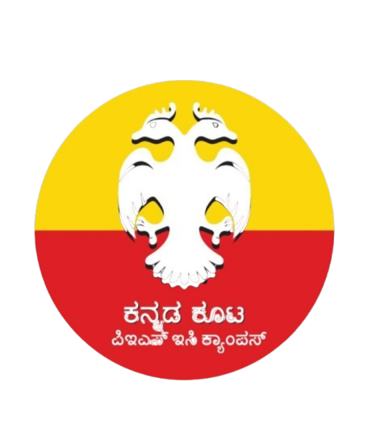

# ಕನ್ನಡ ಕೂಟ | Kannada Koota – PES University, Electronic City

<p align="center">
  
</p>

<h3 align="center">Celebrating Kannada Language, Culture & Heritage</h3>

<p align="center">
  <a href="https://www.kannadakootaecc.in/"><strong>Visit Website</strong></a>
  &nbsp;·&nbsp;
  <a href="https://www.kannadakootaecc.in/">Official Website</a>
</p>

---

## About the Project

**Kannada Koota – PES University, Electronic City Campus** is the official website of the Kannada cultural club at PES University, Electronic City.

The platform celebrates Karnataka's rich cultural heritage, language, traditions, art, and community. It serves as a central digital space for students to explore the club, discover its activities, revisit past celebrations, meet the team, and stay connected with upcoming events.

Designed with a modern and responsive interface, the website brings together the club's identity, activities, achievements, and media in one place.

## Features

- **Home:** An engaging landing page introducing Kannada Koota, its identity, and its activities.
- **About:** Information about the club, its vision, mission, and cultural significance.
- **Events:** Dedicated sections for upcoming and past events, with event details and visual galleries.
- **Team:** Introductions to the club's leadership, domain heads, and team members, including year-wise representation.
- **Blogs & Media:** A dedicated space for showcasing cultural content, creative work, and video highlights.
- **Gallery:** Visual memories from the club's celebrations, activities, and events.
- **Contact:** A contact section that allows visitors to connect with the club through an integrated email service.
- **Responsive Design:** Optimized layouts for desktops, tablets, and mobile devices.
- **Social Sharing:** Website metadata and preview images for sharing across platforms.

## Tech Stack

| Category | Technologies |
|---|---|
| Frontend | React 18, TypeScript |
| Build Tool | Vite |
| Styling | Tailwind CSS |
| UI Components | shadcn/ui, Radix UI |
| Routing | React Router |
| Icons | Lucide React |
| State Management | TanStack React Query |
| Forms & Validation | React Hook Form, Zod |
| Email Service | Resend, Nodemailer |
| Backend / API | TypeScript API endpoints |
| Testing | Jest, React Testing Library |
| Deployment | Cloudflare Pages |

## Getting Started

Follow these instructions to run the project locally.

### Prerequisites

Make sure you have the following installed:

- Node.js (20 or later recommended)
- npm
- Git

### 1. Clone the Repository

```bash
git clone https://github.com/Kannada-Koota-PESU-EC/KKC-EC-PESU.git
```

Navigate into the project directory:

```bash
cd KKC-EC-PESU
```

### 2. Install Dependencies

```bash
npm install
```

### 3. Configure Environment Variables

Create a `.env` file in the project root:

```bash
cp .env.example .env
```

Configure the following variables:

```env
RESEND_API_KEY=your_resend_api_key
CONTACT_EMAIL_RECIPIENT=your_email@example.com
RESEND_FROM=your_verified_sender_email
```

**Environment variable details:**

| Variable | Description |
|---|---|
| `RESEND_API_KEY` | API key used for sending emails through Resend |
| `CONTACT_EMAIL_RECIPIENT` | Email address that receives contact form submissions |
| `RESEND_FROM` | Sender email address configured with Resend |

Keep your API keys and other secrets private. Never commit your `.env` file to GitHub.

### 4. Start the Development Server

```bash
npm run dev
```

Open the local URL displayed in your terminal to view the website.

### 5. Build for Production

```bash
npm run build
```

The optimized production build will be generated in the `dist/` directory.

To preview the production build locally:

```bash
npm run preview
```

## Available Scripts

| Command | Description |
|---|---|
| `npm run dev` | Starts the local development server |
| `npm run build` | Generates the production build |
| `npm run build:dev` | Generates a development-mode build |
| `npm run preview` | Previews the production build locally |
| `npm run lint` | Runs ESLint to check code quality |
| `npm run test` | Runs the Jest test suite |

## Project Structure

The project follows a feature-oriented architecture, keeping related components, pages, data, and services organized.

```text
KKC-EC-PESU/
│
├── api/                    # API endpoints
│
├── config/                 # Vite, ESLint, Jest and TypeScript configuration
│   └── tsconfig/
│
├── functions/              # Cloudflare Pages Functions
│   └── api/
│       └── send-email.ts
│
├── public/                 # Static assets
│   ├── DomainHeads/        # Team and domain head photographs
│   ├── Events/             # Event photographs and videos
│   └── ...                 # Logos and other assets
│
├── src/
│   ├── app/                # Application setup and routing
│   ├── features/           # Feature-specific modules
│   │   ├── home/
│   │   ├── events/
│   │   ├── team/
│   │   ├── blogs/
│   │   ├── contact/
│   │   └── ...
│   │
│   ├── shared/             # Reusable components and utilities
│   │   ├── components/
│   │   ├── hooks/
│   │   └── lib/
│   │
│   └── main.tsx            # Application entry point
│
├── .env.example            # Environment variable template
├── .gitignore
├── index.html              # HTML entry point and SEO metadata
├── package.json
├── package-lock.json
└── README.md
```

## Email Integration

The website includes an email-based contact workflow.

- Visitors can submit messages through the contact form.
- The backend processes the submitted information.
- Resend is used as the email delivery service.
- Environment variables are used to configure the API credentials, sender, and recipient.
- Cloudflare Pages Functions handle the production email endpoint.

For local development, the Vite configuration also provides an API middleware for the contact endpoint.

## Deployment

The website is deployed using **Cloudflare Pages** and is connected to the project's GitHub repository.

### Deployment Configuration

| Setting | Value |
|---|---|
| Platform | Cloudflare Pages |
| Framework | React + Vite |
| Build command | `npm run build` |
| Build output directory | `dist` |
| Production branch | `main` |
| Custom domain | `www.kannadakootaecc.in` |

### Deployment Steps

1. Connect the GitHub repository to Cloudflare Pages.
2. Configure the build command as `npm run build`.
3. Set the output directory to `dist`.
4. Configure the required environment variables in Cloudflare.
5. Deploy the project.
6. Configure the custom domain through Cloudflare Pages.

Cloudflare Pages automatically builds and deploys new changes when updates are pushed to the configured production branch.

## Contributing

Contributions from Kannada Koota team members and developers are welcome.

To contribute:

1. Fork the repository or create a feature branch.
2. Make your changes in the appropriate feature module.
3. Test your changes locally.
4. Run the lint and test commands.
5. Commit your changes with a descriptive commit message.
6. Submit a Pull Request for review.

Please avoid committing API keys, credentials, or other sensitive information.

## Maintained By

**Kannada Koota – PES University, Electronic City Campus**

Built to celebrate Kannada culture, preserve traditions, and bring the community together.

---

<p align="center">
  <strong>ನಮ್ಮ ಭಾಷೆ, ನಮ್ಮ ಹೆಮ್ಮೆ, ನಮ್ಮ ಸಂಸ್ಕೃತಿ ❤️</strong>
  <br/>
  <sub>Our Language. Our Pride. Our Culture.</sub>
  <br/><br/>
  <a href="https://www.kannadakootaecc.in/">www.kannadakootaecc.in</a>
</p>
